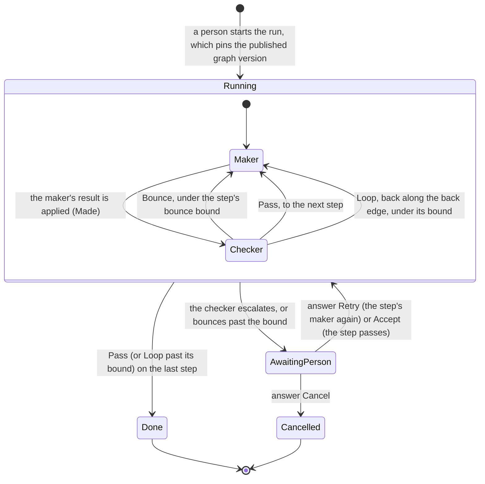
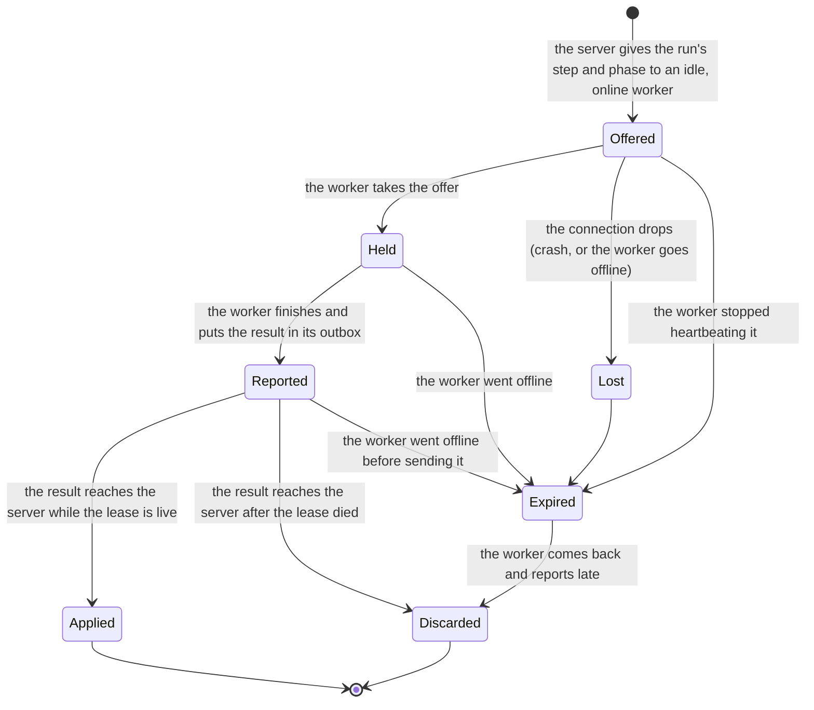

# The graph runner's spec, in plain words

abc's server runs graphs: a review, later a build, as a series of steps. It never does a step's
work itself. It leases each step to a worker, the `abc worker` on someone's machine, which runs
the work with that person's own `claude` and reports back. This document says what the runner
must do, and what it must never do, in sentences a person can check. The same rules are written
in Quint in [`spec/runner/runner.qnt`](../../spec/runner/runner.qnt), and `cargo xtask spec`
checks them with the TLC model checker in every `cargo xtask check` and in CI. Each section names
the Quint definition it explains, in `code`.

If a sentence here is not what abc needs, the spec is wrong: say so on the pull request.

## What the spec covers, and what it leaves out

It covers one server, any number of workers and runs, and a graph of steps run one at a time. It
covers the faults abc must survive: the server crashing and restarting, workers going offline
and coming back much later, messages lost with a connection, and results sent twice.

It leaves out, on purpose:

- what a step does (an agent, a code step, a gate), which does not change how it is run;
- clock time: a lease expires when its worker stops answering, whenever that is;
- steps that run side by side, which S3 adds;
- how a person is told about an escalation (S1's inbox and Web Push), and who may answer;
- several servers sharing one database.

## The parts

**The server** keeps an append-only **event log** (`log`) in Postgres. Every decision the runner
makes is one event, written in the same transaction as its effect. In memory it keeps the runner's
**state** (`view`): each run, and each lease it ever gave. It holds nothing else: after a crash,
replaying the log rebuilds the state exactly (`replay`).

**A graph** (`GRAPHS`) is a list of steps under a version number. Each step has:

- a **bounce bound** (`maxBounces`): how many times its checker may send the work back to its
  maker before the step needs a person;
- at most one **back edge** (`loop`) to an earlier step or itself, with its own **bound**: how
  many times in a run the run may take it.

**A run** (`Run`) runs one graph version. It is on one step at a time, in one **phase**: the
**maker** does the step's work, then a **checker**, with fresh eyes, judges it.

**A lease** (`Lease`) gives one run's step and phase to one worker. A lease is **live** until its
result is applied or it expires. Each run counts the results applied to it (`epoch`); a lease
carries the count at the time it was given, so the runner can tell a current result from a stale
one.

**A worker** (`Worker`) is online or offline. It receives lease **offers** over its connection,
**holds** the work it took, and keeps the results it has not yet had acknowledged in an
**outbox** on its own disk, which survives the worker going to sleep.

## A run's states

- **Running** (`Running`): the run waits for its step's lease, or for the result of the live
  one. Within it, the phase says whose work is due.
- **Awaiting a person** (`AwaitingPerson`): the run is **parked** on an escalation. It holds no
  lease and no worker; it waits for a person's answer for as long as that takes.
- **Done** (`Done`): the last step passed.
- **Cancelled** (`Cancelled`): a person answered an escalation with Cancel.

What each result does to the run (`afterOutcome`, `advance`, `bounce`):

- **Made**, the maker's result: the step moves to its checker.
- **Pass**: the step is done, and the run moves to the next step, or is done after the last.
- **Loop**: the step is done and asks to go back. If the step has a back edge and the run has
  taken it fewer times than its bound, the run goes back to the edge's target. Otherwise it goes
  forward as for Pass: a cycle stops at its bound.
- **Bounce**: the checker sends the work back. Under the step's bounce bound, the maker does the
  step again; at the bound, the run parks for a person.
- **Escalate**: the checker asks a person. The run parks.

Moving to another step starts the bounce count afresh; back-edge counts last the whole run.

What a person's answer does (`afterAnswer`): the run **resumes at the step it parked on**.

- **Retry**: the step's maker works again, with a fresh bounce count.
- **Accept**: the step passes, and the run moves on as for Pass.
- **Cancel**: the run ends, cancelled.

## A lease's life

The server's side, step by step:

- **Grant** (`grant`): a running run with no live lease gets one, for its current step and
  phase, given to an **idle** worker: online, and holding no live lease (`idleWorkers`). A worker
  works on one step at a time. The offer is sent over the worker's connection.
- **Expire** (`expire`, `expirable`): the server expires a run's lease once its worker stops
  heartbeating it. A worker heartbeats a lease while it is online and the offer is in flight to
  it, or it holds the work, or the result waits in its outbox (`keepsAlive`). So a lease
  expires when its worker went offline, or when the offer was lost in a crash. Expiry frees the
  step for another worker.
- **Apply** (`deliver`, `accepts`): when a result arrives, the runner applies it only if its
  lease is still live. A live lease is always the run's current one, so its result is the one the
  run waits for. Applying it ends the lease and counts the result. Any other result is discarded.
  Either way the server acknowledges it, and the worker drops it from its outbox; if the
  acknowledgement is lost, the worker sends the result again, and it is discarded then.

The worker's side:

- **Take** (`take`): an online worker takes an offer and starts the work.
- **Finish** (`finish`): it finishes the work and puts the result in its outbox. A maker reports
  Made; a checker reports Pass, Loop, Bounce or Escalate.
- **Go offline** (`lose`): a laptop sleeps or loses its network. Offers in flight to it are lost;
  it keeps its work and its outbox.
- **Come back** (`back`): it comes back online, maybe long after its leases expired, and goes on
  with what it held. Whatever it reports for an expired lease is discarded.

## The server's life

- **Crash** (`crash`): the server stops. It loses its memory and its connections, and with them
  the offers in flight. The event log survives.
- **Recover** (`recover`): the server restarts and replays the log to rebuild its state. Leases
  that were live are live again; those whose workers no longer answer then expire as usual.

## Graph versions

Graphs are data with versions. **Publish** (`publish`) makes a newer version the one new runs
start on. A run **pins** the published version when it starts (`startRun`), and its start event
records it, so neither a newer version nor a crash and replay can change the graph a run is
running.

## The properties

Each of these is checked in every state TLC can reach in each model below.

1. **At most one live lease per step** (`oneLiveLeasePerStep`). No two leases on the same run's
   same step are live at once, so no two workers do one step's work at the same time.
2. **A step's result is applied at most once** (`resultAppliedOnce`). For each run and each count
   of results, one result is applied, however late a worker that went offline reports, and
   however often a result is sent again.
3. **A run never changes graph version** (`versionPinned`). A run's version is always the one
   published when it started, through new versions, crashes and replays.
4. **Bounces and cycles never pass their bounds** (`boundsHold`). A step is never bounced back
   more often than its bounce bound, no back edge is taken more often than its bound, and a run
   is always on a step of its own graph.
5. **Replaying the log rebuilds the same state** (`replayRebuildsState`). Whenever the server is
   up, its state is exactly what replaying its log gives. Every event carries everything its
   effect depends on.
6. **A parked run holds no worker** (`onlyRunningRunsHoldLeases`). Only running runs hold live
   leases, so a run waiting on a person never ties up a worker.

`safety` is all six together. And one property about the future:

7. **No silent stall** (`noSilentStall`). Every running run eventually ends (done or cancelled)
   or waits on a person. It cannot sit forever with nobody able to move it.

This holds under these assumptions about the world (`fairness`), and no others:

- the server comes back after a crash;
- a worker that went offline comes back;
- anything the runner or a worker can do, and goes on being able to do, it eventually does:
  grant a free step, expire a lease nobody heartbeats, take an offer, finish work, send a result;
- there are finitely many faults: crashes, workers going offline and acknowledgements lost.

People are not assumed to answer, to start runs or to publish graphs. A run parked on a person
may wait forever: that is waiting on a person, not a stall.

## The models TLC checks

TLC explores every state reachable in a model, so a model must be finite. Each fixes the runs,
the workers, the graphs and how many faults and answers the world produces in a behaviour. No
single model with every behaviour finishes in CI time, so each model keeps what its concern
needs (`spec/runner/model.qnt`):

| Model | Runs | Workers | Graphs | Faults | Answers | What it is for |
| --- | --- | --- | --- | --- | --- | --- |
| `leases` | 1 | 2 | one step, no bounces | 2 | 0 | Leases, expiry, late workers, lost offers, resent results and crash recovery, with two workers racing for the same step. |
| `flow` | 1 | 1 | version 1: two steps, the first bouncing once, the second with a back edge to the first, bound 1; version 2: one step | 0 | 1 | Every result, the bounce and cycle bounds, escalation and every answer, and a newer version published while the run is under way. |
| `contention` | 2 | 1 | one step | 1 | 0 | Two runs sharing one worker, which works on one step at a time. |

Every model must hold `safety` and `noSilentStall`. `cargo xtask spec` prints each model's state
count and time.

## Seeded bugs

The gate keeps two broken runners (`spec/runner/seeded.qnt`), and TLC must find each one's bug.
If a property stops catching its bug, the gate fails.

- `keepLeaseOnExpiry`: expiry frees the step but leaves the lease live. TLC must show two live
  leases on one step: a worker goes offline, its lease expires, and the step goes to a second
  worker while the first lease is still live.
- `applyStaleResult`: the runner applies any result whose lease is for the run's current step and
  phase, live or not. TLC must show a result applied twice: a result whose acknowledgement was
  lost is sent again after the step came back to the same phase, or a worker that went offline
  reports after its replacement did.

## Scenarios

`spec/runner/tests.qnt` drives the runner through stories step by step, each checked by
`quint test`: a run that passes every step; bounces up to the bound and the escalation after it;
an answer resuming the parked step; a back edge taken once and then passed by; a late worker's
result discarded; a resent result applied once; a crash recovered by replay; a run keeping its
graph version; and leases refused where they may not go.

## Traces for the Rust runner

`cargo xtask spec --traces <dir>` also simulates each model 100 times, up to 100 steps each, with
a fixed seed, and writes each simulation to `<dir>/<model>_<n>.itf.json`. The Rust runner (S1 B2)
replays these against its own code and must agree at every step.

Each file is an [ITF trace](https://apalache-mc.org/docs/adr/015adr-trace.html), JSON:

- `#meta` describes the trace (format, source file, status).
- `vars` lists the variables, named by module path: `leases::runner::log`,
  `leases::runner::view`, `leases::runner::up`, `leases::runner::published`,
  `leases::runner::workers`, `leases::runner::budget`, `leases::runner::ghost`, and the two
  model-based-testing variables below.
- `states` is the list of states, in order. Each maps every variable to its value, with
  `#meta.index` its position.
- `mbt::actionTaken` is the name of the action that led to the state: `init`, then one of
  `startRun`, `lose`, `back`, `crash`, `recover`, or a `…Some` action, which makes one of the
  choices its action takes as parameters: `grantSome` (`grant`), `expireSome` (`expire`),
  `deliverSome` (`deliver`), `answerSome` (`answer`), `takeSome` (`take`), `finishSome`
  (`finish`), `publishSome` (`publish`).
- `mbt::nondetPicks` records the choices made on the way, each `{"tag": "Some", "value": v}`
  when it was made and `{"tag": "None", ...}` otherwise: `r` the run and `w` the worker the step
  is about, `id` the lease, `work` the offer or work, `outcome`, `result`, `ackLost`, `a` the
  answer, `version`.

Values are encoded as ITF says: integers as `{"#bigint": "3"}`, sets as `{"#set": [...]}`, maps
as `{"#map": [[key, value], ...]}`, tuples as `{"#tup": [...]}`, records as JSON objects, lists
as arrays, and a variant such as `Running` or `Some(3)` as `{"tag": "Running", "value": ...}`.

To replay a trace, B2 starts from the first state, performs each step's action with its picks on
the Rust runner, and compares the runner's event log and state with `log` and `view` after every
step; `ghost` and `budget` belong to the model, not the runner.

## Running it

`cargo xtask spec` runs the gate alone; `cargo xtask check` runs it when `spec/` or the pinned
tools changed, and always in CI. It needs the pinned Quint, Apalache and JRE
(`cargo xtask setup`). A failing property prints TLC's trace: the states, in order, each with the
action that led to it, ending in the state that breaks the property, or, for `noSilentStall`, the
loop a run never leaves.

Quint turns each model into TLA+ through an Apalache server, which the gate starts for its run on
a free port and stops at the end. Apalache's server listens on every network interface, with no
option to listen on loopback alone, so while the gate runs, other machines that can reach yours
can reach that port. Run the gate on networks you trust, or behind a firewall that blocks
incoming connections.
